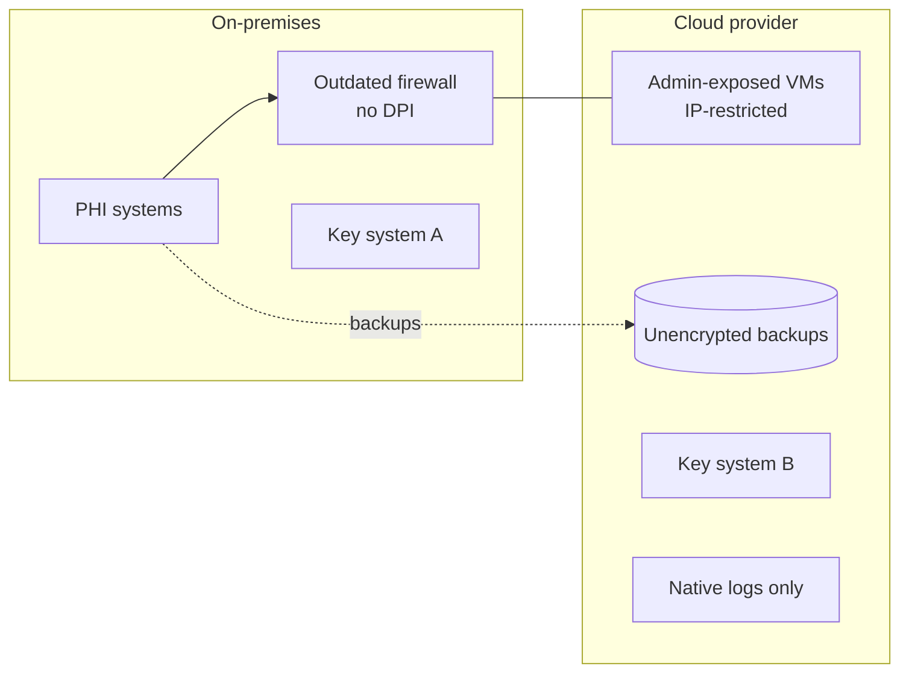
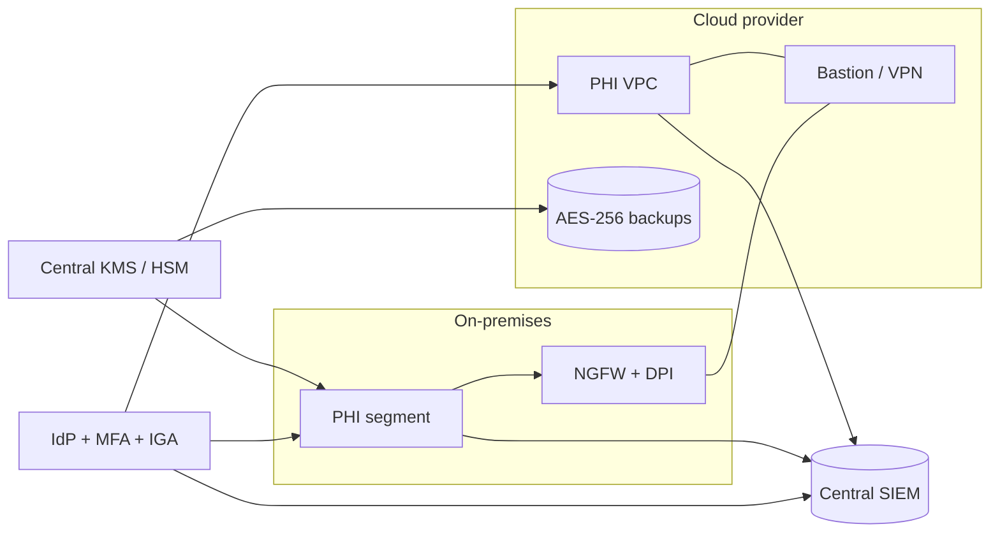

# Current vs Target Architecture

## Current state

## Target state

NGFW + segmentation, bastion/VPN for admin, one KMS/HSM for all keys, encrypted backups,
MFA everywhere, and a single SIEM ingesting on-prem, cloud, and identity logs.

